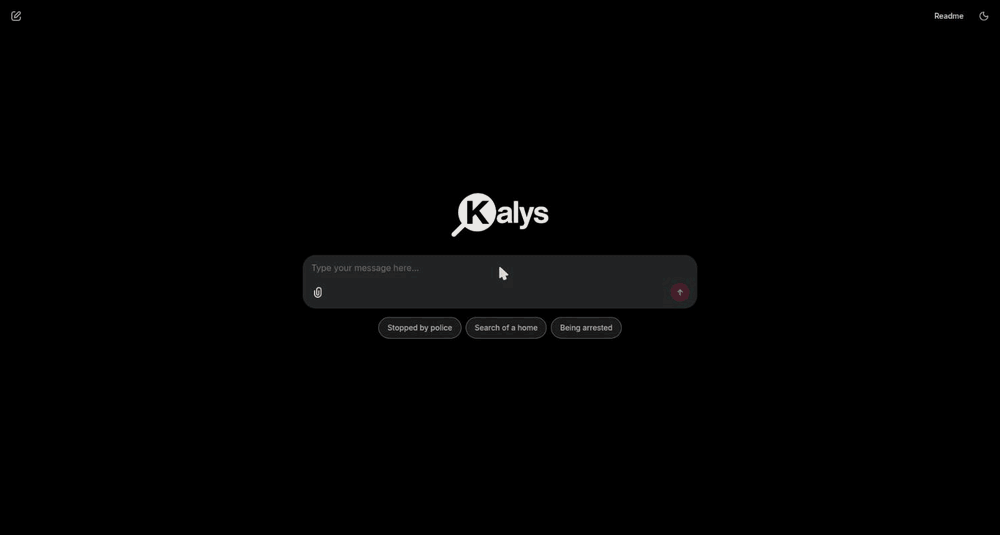

# Kalys

**Search Kyrgyz law in English, Kyrgyz, or Russian, and get answers with exact citations.**

Ask a legal question in any of the three languages. Kalys answers in the same language
and cites the exact source: the act, article, part, and edition date.

*A real answer from the running app. Every point carries the act, the article number, and
the edition date it came from.*

> Status: working end to end - 86,527 articles across 91 editions, hybrid search, and
> answers from Amazon Bedrock grounded in the retrieved text. Runs on AWS. The public site
> at https://kalys.eraliev.com is not up yet.

## Why it matters

- **The 2021 legal reform.** Kyrgyzstan adopted a new Constitution and replaced its main
  codes in 2021, including the Criminal Code and the Criminal Procedure Code. Many old guides
  and answers online are now out of date.
- **Two official languages.** Every law exists in Kyrgyz and Russian. Both texts are
  official, so Kalys keeps both.
- **No official English text.** Foreign investors, researchers, and NGOs cannot read the
  originals. Kalys adds an English machine translation of every article, always shown next to
  the original and always labeled *"Machine translation. Not an official text."*

## Scope (first version)

| Act | Year |
| --- | --- |
| Constitution of the Kyrgyz Republic | 2021 |
| Criminal Code | 2021 |
| Criminal Procedure Code (No. 129, 28 Oct 2021) | 2021 |

Every edition of every act is kept, so a citation always points to a dated version.

## Tech stack

- **Python 3.12**, managed with **uv**
- **PostgreSQL** (local, with Docker Compose) for articles and editions
- **pgvector** and a local **sentence-transformers** model for semantic search, merged
  with PostgreSQL full-text search using Reciprocal Rank Fusion
- **Amazon Bedrock** (Claude) for the answers, reached through an IAM role on the instance
  so no key is ever stored on the server
- **Chainlit** for the chat UI, served from one EC2 instance and reached over SSM Session
  Manager, with no port open to the internet
- **pytest** and **ruff**, run in **GitHub Actions** CI

## Data source

Official texts come from the Ministry of Justice legal database
([cbd.minjust.gov.kg](https://cbd.minjust.gov.kg)). The downloader is polite: max 1 request
per second, a clear User-Agent with contact info, and a local cache, so each page is downloaded only once.

## Roadmap

- [x] Project setup and CI
- [x] Check the Ministry of Justice API ([notes](docs/cbd-api.md))
- [x] Download all editions of the 3 acts in Kyrgyz and Russian
- [x] Split texts into articles and store them in PostgreSQL (86,527 articles, 91 editions)
- [x] English machine translation of every article of the current editions (1,100)
- [x] Hybrid search (keyword + vector, merged with Reciprocal Rank Fusion)
- [x] Answers with citations (Amazon Bedrock)
- [x] Web UI (English by default, sample questions)
- [x] AWS deployment and a cost cap on how much the chat can spend
- [x] A labelled evaluation set, to measure retrieval instead of guessing at it
- [ ] Fix Kyrgyz retrieval (see the numbers below)
- [ ] HTTPS and a public address
- [ ] More acts: the other in-force codes

## How good is the search?

125 questions in three languages, each labelled by hand with the article that
answers it (`eval/questions.jsonl`). Scored with `uv run python -m kalys.evaluate`,
which runs the same search the chat uses and calls no paid API.

| Language | Questions | hit@10 | MRR |
| --- | --- | --- | --- |
| English | 65 | 0.94 | 0.706 |
| Russian | 30 | 0.93 | 0.744 |
| Kyrgyz | 30 | 0.53 | 0.349 |
| **All** | **125** | **0.84** | **0.629** |

*hit@10* is the share of questions where a correct article is in the top 10,
which is what the model is shown. *MRR* averages 1/rank of the first correct
article, so being right at rank 1 counts for more than being right at rank 9.

**Kyrgyz is the weak point, and the overall average hides it.** Both halves of
the hybrid search fail there: PostgreSQL has no Kyrgyz stemmer, so keyword
search matches whole words only while Kyrgyz builds meaning with suffixes; and
the multilingual embedding model encodes Kyrgyz poorly, so the question does
not land near the right articles even in the shared vector space. Fixing this
is the next piece of work, and the numbers above are the baseline to beat.

## Disclaimer

Kalys is a student portfolio project. It is not legal advice.
